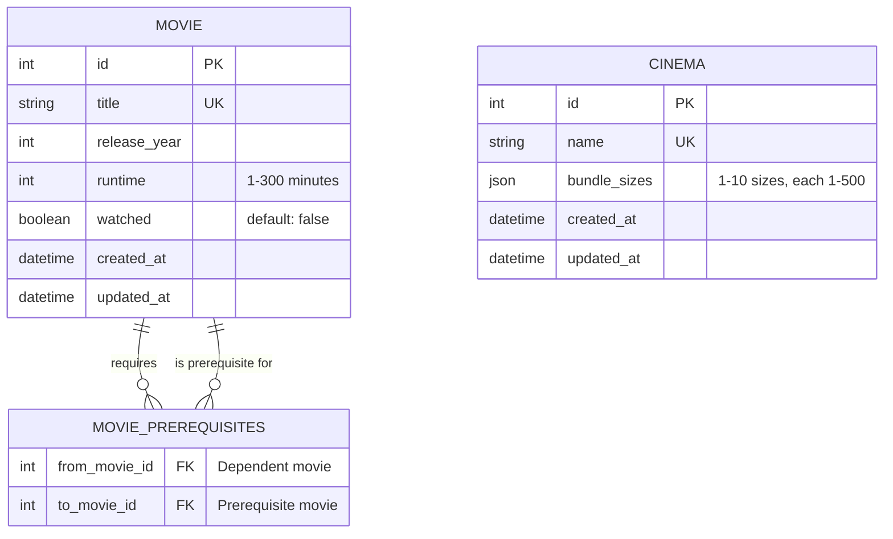

# Doomsday Ready - MCU Rewatch Planner & Watch-Party Booking

[](https://python.org)
[](https://djangoproject.com)
[](https://react.dev)
[](https://typescriptlang.org)
[](https://mui.com)
[](https://docker.com)
[](https://postgresql.org)


**Doomsday Ready** is a full-stack web application designed for MCU (Marvel Cinematic Universe) fans preparing for *Avengers: Doomsday*. It solves two core challenges:

1. **Viewing Order Planner**: Many MCU movies build on earlier ones. Given a target movie, the app returns every prerequisite in the exact chronological dependency order (using topological sort), tracking watch progress and unwatched runtime, while strictly rejecting circular dependencies.
2. **Watch-Party Booking Engine**: Cinemas sell opening-night seats strictly in fixed bundles. Given a cinema and group size, the app computes the minimum number of bundles needed so *zero seats are wasted*, or confirms if no exact combination exists.

<a href="https://doomsday-ready-2.onrender.com/" target="_blank">Doomsday Ready (Click to view)</a>

---

## System Architecture

```
┌────────────────────────────────────────────────────────┐
│                        Client                          │
│    React 18 + TypeScript + Vite + Material UI (MUI)    │
│       • Dark/Light Theme                               │
│       • Responsive Design & Interactive Components     │
└──────────────────────────┬─────────────────────────────┘
                           │ HTTP / JSON
                           ▼
┌────────────────────────────────────────────────────────┐
│               Nginx Reverse Proxy (:80)                │
│    Routes /api/* to Django, serves static frontend     │
└──────────────────────────┬─────────────────────────────┘
                           │
                           ▼
┌────────────────────────────────────────────────────────┐
│             Django REST Framework (:8000)              │
│       • Service Layer Architecture (services.py)       │
│       • Custom DFS Cycle Detection Algorithm           │
│       • Custom Kahn's Topological Sort Algorithm       │
│       • Custom Dynamic Programming Bundle Solver       │
└──────────────────────────┬─────────────────────────────┘
                           │
                           ▼
┌────────────────────────────────────────────────────────┐
│                 PostgreSQL Database                    │
│           Movies, Prerequisites (DAG), Cinemas         │
└────────────────────────────────────────────────────────┘
```

---

## 📊 Data Model Diagram



## Screenshots


### Model Descriptions

* **`Movie`**: Stores movie metadata and watched status.
* **`prerequisites`**: A Directed Acyclic Graph (DAG) of watch dependencies. Self-references and cycles are strictly blocked.
* **`Cinema`**: Stores cinema name and an array of seat bundle sizes available for opening night.

---

## Algorithmic Implementation (No Third-Party Solvers)

All core logic for Features are written from scratch in `backend/api/services.py` without using external graph or optimization libraries:

### 1. Circular Dependency Detection (`detect_circular_dependency`)
* **Algorithm**: Depth-First Search (DFS) Cycle Detection with recursion stack tracking.
* **Mechanism**: When setting prerequisites for Movie $A$, we simulate adding edges $A \rightarrow P_i$. For each prerequisite $P_i$, we perform DFS across existing edges to check if Movie $A$ is reachable from $P_i$. If $A$ is reachable, adding $P_i$ would form a directed cycle.
* **Self-Dependency**: Explicitly validated ($A \rightarrow A$ is rejected immediately).
* **HTTP Response**: Rejections return `HTTP 409 Conflict` with `{"error": "CIRCULAR_DEPENDENCY"}`.

### 2. Rewatch Order / Topological Sort (`get_rewatch_order`)
* **Algorithm**: Kahn's Algorithm (BFS-based Topological Sort).
* **Mechanism**:
  1. **Transitive Closure**: Runs BFS starting from the target movie's direct prerequisites to discover *all* upstream prerequisites transitively.
  2. **Subgraph Construction**: Extracts an induced subgraph consisting only of the discovered movies.
  3. **In-Degree Calculation**: For each movie $M$, in-degree is computed as the number of prerequisites $M$ must wait for.
  4. **Kahn's Queue**: Movies with an in-degree of 0 (no remaining prerequisites) are dequeued and added to the watch list. Their dependent movies have their in-degrees decremented.
  5. **Metrics Computation**: Tallies watched count and total runtime of unwatched movies.

### 3. Watch-Party Bundle Quote (`get_booking_quote`)
* **Algorithm**: Dynamic Programming (Unbounded Knapsack / Minimum Coin Change variant).
---

## 🎨 Design Patterns & Engineering Standards

* **Layered Architecture**: Separation of concerns across:
  * `models.py` (Data Access Layer)
  * `serializers.py` (Validation & Serialization Layer)
  * `services.py` (Pure Business Logic & Algorithms)
  * `views.py` (HTTP Transport & Presentation Layer)
* **Single Responsibility Principle**: Algorithm implementations in `services.py` are pure Python functions decoupled from Django request/response objects, making them 100% unit-testable.
* **Strict Environment Configuration**: Secrets and credentials loaded via `django-environ` (backend) and `import.meta.env` (Vite frontend).
* **Custom Theme Context**: Dynamic Dark/Light mode state with localStorage persistence.
* **Compound Component Patterns**: Modular UI components (`MovieCard`, `MovieDialog`, `CinemaCard`, `CinemaDialog`, `ProgressBar`).

---

## 🚀 Quickstart with Docker Compose 

Run the entire application

```bash
cd doomsday-ready
docker compose up --build
```

The database is automatically migrated and seeded with the complete MCU sample dataset and cinemas upon startup.

---

## 🛠️ Manual Local Development Setup

### Prerequisites
* Python 3.12+
* Node.js 18+ and npm
* PostgreSQL running locally (e.g., via pgAdmin 4)

### 1. Database Setup (pgAdmin 4)
Create a PostgreSQL database named `doomsday_ready` with user `postgres` and password `your password`:
```sql
CREATE DATABASE doomsday_ready;
```

### 2. Backend Setup
```bash
cd doomsday-ready/backend

# Create and activate virtual environment
python -m venv venv
source venv/Scripts/activate

# Install dependencies
pip install -r requirements.txt

# Run migrations
python manage.py makemigration
python manage.py migrate

# Seed sample data
python manage.py seed_data

# Run development server
python manage.py runserver
```

### 3. Frontend Setup
```bash
cd doomsday-ready/frontend

# Install dependencies
npm i

# Start Vite dev server
npm run dev
```

Visit [http://localhost:5173](http://localhost:5173)

---

## Running Automated Tests

The backend includes a comprehensive test suite covering all features, edge cases, cycle detection, topological sorting, and DP bundle calculations:

```bash
cd doomsday-ready/backend
python manage.py test
```

### Test Coverage Highlights
* `test_circular_dependency`: Ensures cycles (direct and multi-hop) trigger detection.
* `test_circular_dependency_409`: Confirms API returns HTTP 409 Conflict.
* `test_self_dependency`: Verifies a movie cannot depend on itself.
* `test_rewatch_doomsday`: Verifies all 7 transitive prerequisites returned in valid order.
* `test_rewatch_civil_war`: Verifies partial prerequisite subtrees.
* `test_rewatch_ragnarok`: Verifies empty list for movies without prerequisites.
* `test_exact_match`, `test_mixed_bundles`, `test_not_possible`: Validates all DP booking examples.

---

## API Reference

Base path: `/api`

| Method | Path | Description | Expected Status |
|--------|------|-------------|-----------------|
| `POST` | `/movies/` | Create a movie with title, year, runtime, prerequisites | `201 Created` / `409 Conflict` |
| `GET` | `/movies/` | List all movies with prerequisites and details | `200 OK` |
| `PATCH` | `/movies/:id/` | Update movie title, watched status, prerequisites | `200 OK` / `409 Conflict` |
| `GET` | `/movies/:id/rewatch-order/` | Get topological rewatch order and progress | `200 OK` / `404 Not Found` |
| `POST` | `/cinemas/` | Create a cinema with name and bundle sizes | `201 Created` / `400 Bad Request` |
| `GET` | `/cinemas/` | List all cinemas | `200 OK` |
| `GET` | `/cinemas/:id/booking/?groupSize=N` | Calculate minimum bundles for exact seating | `200 OK` / `400 Bad Request` |

---

## AI Usage Statement

* **Scaffolding and Boilerplate**: AI was used to generate initial boilerplate for Vite + React TypeScript configuration and Django project layout.
* **Component Styling**: AI assisted in designing the Material UI theme palette (MCU cosmic dark mode and comic light mode) and responsive CSS layouts.
* **Algorithm Design**: The core algorithms (DFS cycle detection in `detect_circular_dependency`, Kahn's algorithm in `get_rewatch_order`, and bottom-up DP in `get_booking_quote`) were designed strictly from first principles using standard computer science theory without relying on third-party graph or solver packages.
---

## Assumptions & Design Choices

1. **Topological Order Ambiguity**: For target movies with parallel prerequisite paths (e.g., *Iron Man* vs *Captain America: The First Avenger*), multiple valid topological orders exist. The algorithm returns any mathematically valid topological order where each movie precedes all movies that depend on it.
2. **Dynamic Programming for Group Sizes**: The problem specifies group sizes up to 10,000 and bundle sizes up to 500. A standard $O(N \times B)$ bottom-up dynamic programming approach was chosen because $10{,}000 \times 10 = 100{,}000$ operations execute in under 15ms in pure Python, well within real-time API response budgets.
3. **Circular Dependency Response**: As requested by the specification, circular dependency violations return `HTTP 409 Conflict` with `{"error": "CIRCULAR_DEPENDENCY"}`.
4. **Data Isolation**: Each movie prerequisite graph is resolved dynamically from the database to guarantee consistency under concurrent updates.
